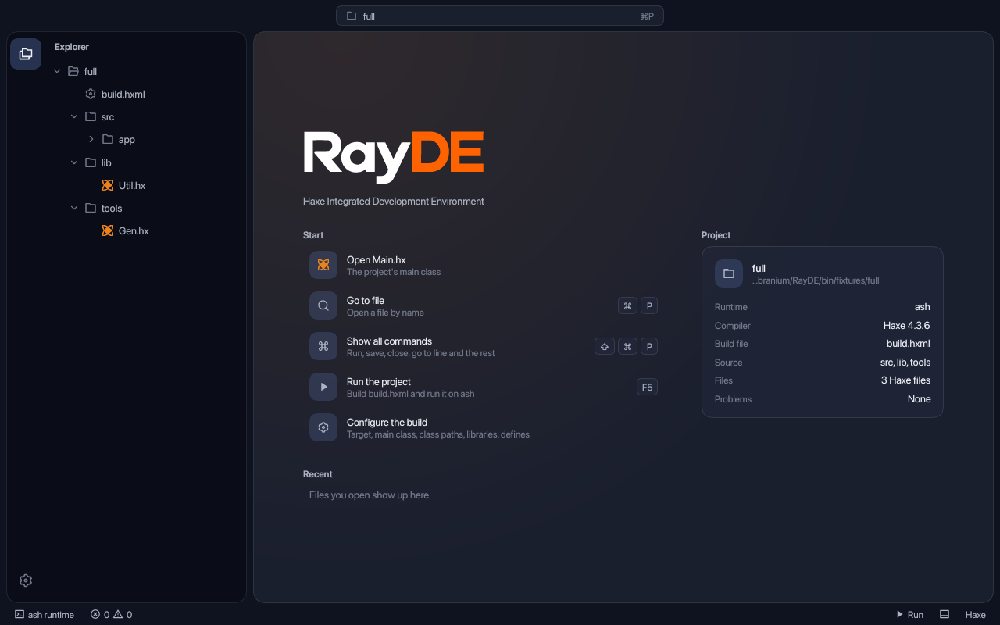

<p align="center"></p>

<h2 align="center">Integrated Development Environment For The Haxe Programming Language</h2>
<p align="center">
  Built with Ashui and the Ash runtime.
</p>

<p align="center"></p>


## Extensions

RayDE extensions are written in RayScript and described by a `.rayext` file. [Writing an extension](docs/extensions.md) covers the config, commands and menus, hooks, reading files, tabs and the Extension Studio, with a Markdown preview as the example.

## Contributor notes

```sh
scripts/rayde.sh path/to/build.hxml   # opens that project; Run builds it and runs it on ash
scripts/rayde.sh --build              # only rebuilds bin/rayde.hl, without opening a window
RAYDE_PANEL=terminal scripts/rayde.sh path/to/build.hxml   # opens with the bottom panel on that tab (terminal, problems or console), the terminal with the keyboard in it
RAYDE_SETTINGS=keys scripts/rayde.sh path/to/build.hxml     # opens the Settings page on that section (build, libraries, terminal, appearance, keys or extensions)
```

Keys, as in VS Code (Ctrl on Linux and Windows): Cmd+P opens the command center, which goes to a file as you type, to a command after `>` (also Cmd+Shift+P) and to a line after `:` (also Cmd+G); clicking the project pill opens it too. Cmd+S saves every edited file, Cmd+W closes the tab, F12 goes to the definition of the name under the cursor, F5 runs and Shift+F5 stops. Cmd+M minimizes the window and Ctrl+Cmd+F (F11 elsewhere) toggles full screen. A problem in the Problems list opens its file at its line.

### The window

RayDE opens without the system's frame and draws its own title bar: the bar moves the window, a double click on it maximizes, the edges and corners resize it, and the close, minimize and maximize controls are RayDE's, in the style of the platform (macOS lights on the left; Windows, GNOME and KDE controls on the right). Settings > Color scheme > Window controls picks another style, and `appearance.windowControls` in `.rayde/settings.json` (`auto`, `macos`, `windows`, `gnome`, `kde`) keeps it. `rayde.ui.WindowChrome` is what the controls ask of the window; with no window, as in the snapshots, it records the requests.

### Checks

```sh
scripts/check.sh      # the language and run layers against the real compiler, run with ash (ASH, or ash on PATH)
scripts/snapshot.sh   # the workbench in both themes, empty, with problems, after a run and after a failed build, into bin/snapshots
scripts/terminal-bench.sh # the terminal under a program that fills the screen as fast as it can, offscreen: poll and layout, encode (and the native library has its own `cargo test` in native/terminal)
scripts/scroll-bench.sh # frames of a long file flicked and left to decelerate, offscreen: layout, encode and finish times (ROWS=<n> sets the length; DRIFT=<frames> STEP=<px> scrolls at a steady pace; ALONE=gfib puts the editor on its own, a letter for each feature on)
```

The UI builds against a pinned ashui commit (`ashui_rev` in `scripts/deps.sh`), checked out under `.deps` and built once; `ASHUI=<dir>` uses another checkout. hlwgpu and hlwindow are read from beside RayDE. Look at the snapshots after any change to how something looks.

### App icon and packaging

The icon is `assets/rayde-icon.png`, a rounded square on a transparent margin. `scripts/icons.sh` derives each platform's icon from it into `assets/icons`, which is committed: only a change to the icon needs ImageMagick (`magick`), and macOS also `iconutil`.

| Platform | Icon | Packaged with |
| --- | --- | --- |
| macOS | `rayde.icns`, the icon on the Big Sur grid with its shadow | `scripts/package-macos.sh [folder]` builds `RayDE.app` |
| Linux | `hicolor/<n>x<n>/apps/rayde.png`, 16 to 1024 px | `scripts/package-linux.sh [prefix]` installs the launcher, desktop entry, MIME types and icons |
| Windows | `rayde.ico`, 16 to 256 px | `packaging/windows/RayDE.cmd` and `install-shortcut.ps1` |
| Window | `rayde-256.rgba`, embedded in the program and passed as `WindowConfig.icon` | every run (Windows and Linux windows; macOS takes the bundle's) |

The packaged launchers run the program with ash, which is not bundled: `RAYDE_ASH` names it, otherwise it is looked for in the usual places. Given no project they open a file dialog for a `.hxml` or `.rayext`. The Windows scripts have not been run on Windows.

Work is tracked with git-bug; `git-bug bug` lists it.
