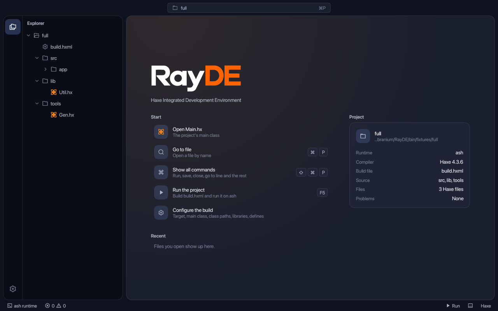

<p align="center"></p>

<h2 align="center">Integrated Development Environment For The Haxe Programming Language</h2>
<p align="center">
  Built with Ashui and the Ash runtime.
</p>

<p align="center"></p>

RayDE is an IDE for Haxe projects. It is written in Haxe on [ashui](https://github.com/rayzor-blade/ashui) and runs on the ash runtime. [Rayzor](docs/languages.md) is its default Haxe language server, with the Haxe compiler's display service as a fallback.

## Features

- **Haxe projects.** Opens a `build.hxml`; the build file is edited as a form. Explorer, tabs, code editor with a minimap, hover types and documentation, go to definition, compiler problems underlined and listed. Run builds the project and runs it on ash.
- **Command center.** Files, commands and line numbers from one prompt. Key bindings follow VS Code and are editable.
- **Syntax and Markdown.** A shared Linguist-derived TextMate bundle highlights code files and fenced blocks. Markdown previews render LaTeX math and Mermaid diagrams with pan and zoom in editor tabs.
- **Terminal.** Integrated terminal panel with configurable profiles.
- **Libraries.** haxelib libraries are listed and managed from Settings.
- **Extensions.** Written in RayScript and described by a `.rayext` file: commands, menus, hooks, views in any part of the layout. Built-in, user and workspace extensions activate on events and run in embedded RayScript VMs. The Extension Studio reloads an extension as it is edited and has a console, an activity log, an element tree and a debugger.
- **Themes.** A `.raytheme` bundle sets colours, radii, type, custom fonts and CSS over a built-in theme. The Theme Studio edits one with the window as the live preview.
- **Window.** RayDE draws its own title bar, resize edges and window controls in the style of the platform.

## Getting started

Install [Ash CLI](https://ash.rayzor.tech/), Haxe 4.3.6 and the [source dependencies](docs/contributing/building.md#first-source-build), then compile and run the editor:

```sh
ASH="$(command -v ash)" scripts/rayde.sh --build
ash bin/rayde.hl                        # Restore windows and tabs, or Welcome on first launch
ash bin/rayde.hl path/to/folder         # a folder workspace, including non-Haxe projects
ash bin/rayde.hl path/to/build.hxml     # a Haxe project
ash bin/rayde.hl path/to/name.rayext    # an extension
ash bin/rayde.hl path/to/name.raytheme  # a theme
```

For a native AOT executable, run `ash --build bin/rayde bin/rayde.hl`, then `./bin/rayde` (`bin/rayde.exe` on Windows). Keep the native libraries beside it. The [build guide](docs/contributing/building.md) includes the macOS/Linux and Windows Ash installers and the one-time dependency setup.

## Documentation

| Chapter | Contents |
| --- | --- |
| [User guides](docs/README.md#user-guides) | Projects, editing, Explorer, builds, previews, Git, Jam and settings. |
| [Writing an extension](docs/extensions.md) | Config, commands, menus, hooks, tabs, Extension Studio, debugger. |
| [Theme bundles](docs/themes.md) | File format, fonts, CSS, installing, Theme Studio. |
| [Contributing](docs/contributing/README.md) | Implementation, building, checks, benchmarks, packaging and issue tracking. |

## License

RayDE is licensed under [Apache-2.0](LICENSE). See [NOTICE](NOTICE) for copyright information. Separately identified third-party components and assets retain their own licenses.
