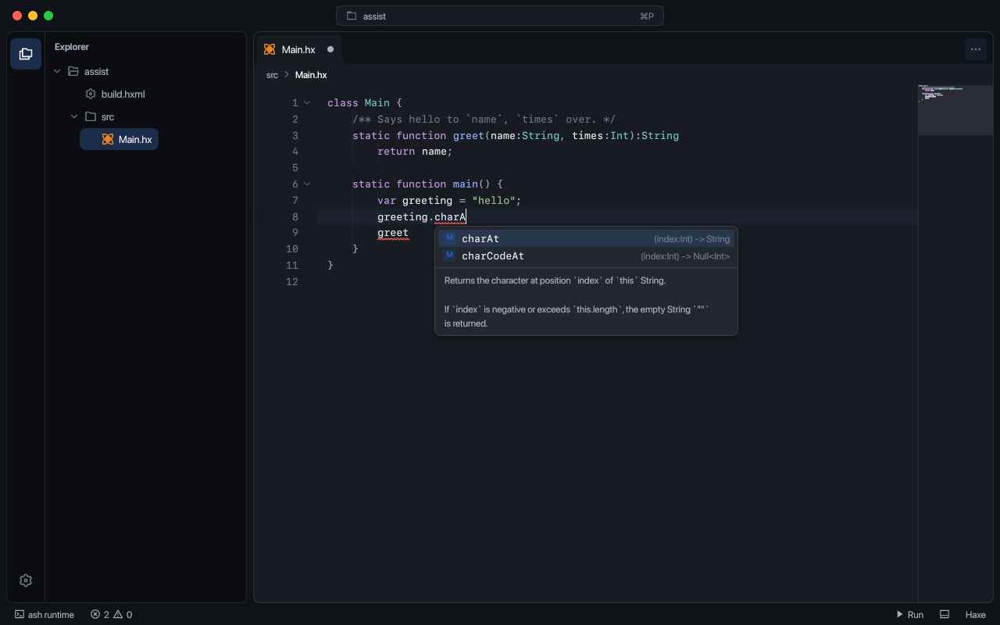
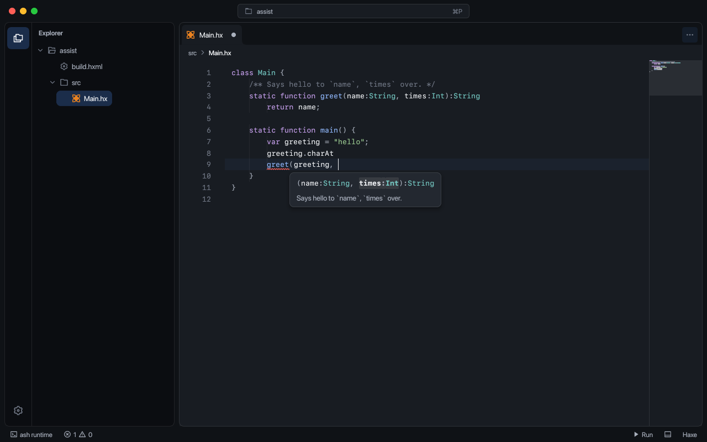

# Editor and keys

The built-in [Rayzor language server](languages.md) provides Haxe services over stdio. Extensions can register servers for other languages.

Launching without arguments reopens the previous session's windows, each with its workspace and saved tabs. Before a window session has been saved, it resumes the most recent workspace. A first launch, or no available workspaces, opens Welcome with Explorer collapsed. A supplied workspace path takes precedence. **Open Folder** opens any folder as a workspace, including non-Haxe projects; it needs no project descriptor and supplies no Haxe build or runtime. **Open Project** accepts `.hxml`, `haxelib.json`, `rayzor.toml`, extensions and themes. Recent projects and folders open directly from Welcome. Opening from an empty Welcome uses that window; opening another workspace from an existing project creates a separate window. On macOS, file and folder browsers open as asynchronous sheets attached to the requesting window. Other platforms run their native picker on a worker. Project creation continues on a worker after selecting a location.

**File > New Window** (Cmd+Shift+N, or Ctrl+Shift+N) opens another Welcome window. Projects have independent tabs, compiler/LSP services, extensions and appearance, sharing the GPU and desktop event loop. Closing one leaves the others running and removes it from the next session; quitting the application preserves all open windows. Closing the last window preserves that workspace for the next launch. Closing a window with edited files offers Save and Close, Don't Save, and Cancel. **Window** lists the open windows and provides minimize, maximize and full-screen actions.

On macOS, File, Edit, View, Go, Run, Terminal, Window and Help appear in the system menu bar and follow the focused window. Windows and Linux show the same menus below the title bar. Editing commands operate on the focused text control; shortcuts follow the selected keymap. The application's Quit/Exit action asks each window to close through its save guard.

**New Project** offers a Haxe application, Haxe library or Rayzor application template, then asks for a name and parent folder; existing folders are never overwritten. Library manifests supply source paths, dependencies and `extraParams.hxml`. Rayzor manifests supply source paths, defines and the entry point, or delegate to an HXML file. Rayzor projects run with `rayzor run`; libraries without an application entry point omit Run. The active HXML or Rayzor manifest opens **Settings > Build** from the Explorer. Library manifests open as code.

The Explorer lists every file type, including dotfiles, with folders first and Haxe files before other files. Configuration files and other languages open in the editor; supported images open in the previewer. Explorer and tab icons use Remix and a bundled MIT-licensed Devicon language subset; unknown types use the file-code icon.

Key bindings follow VS Code. They work from anywhere in the window: the workbench takes the keyboard whenever nothing else has it, such as a window just opened, the Welcome page or after a click on bare space, so Cmd+P and the rest are heard there too. The Explorer's file commands (copy, cut, paste, rename, delete, duplicate) run only while the Explorer has the keyboard. On Linux and Windows read Ctrl for Cmd. **Settings > Key bindings** edits them; user changes are stored in `.rayde/keybindings.json` as `{"command": ..., "key": ...}` entries, and an empty `key` removes a binding.

**Build** is the hammer button beside Run in the bottom toolbar, also available as **Run > Build Project** and in the command center. It saves edited files and invokes the selected HXML with the configured Haxe compiler, preserving its targets, output paths and multiple compilations. Rayzor projects use `rayzor build` from their manifest folder. The compiler runs on a worker; Output shows progress, Problems shows compiler diagnostics, and Stop cancels the job. Build does not add a program launch. **Open Build Settings** remains a separate command.

## Keys

| Key | Action |
| --- | --- |
| Cmd+P | Command center: go to a file as you type. Clicking the project pill opens it too. |
| Cmd+Shift+P, or `>` in the center | Commands. |
| Ctrl+G, or `:` in the center | Go to line. |
| Cmd+F | Find in the current editor. |
| Cmd+Option+F (Ctrl+H elsewhere) | Replace in the current editor. |
| Cmd+G / Cmd+Shift+G (F3 / Shift+F3 elsewhere) | Next / previous match. |
| Cmd+S | Save every edited file. |
| Cmd+W | Close the tab. |
| F12 | Go to the definition of the name under the cursor. Command-click a symbol on macOS, or Control-click elsewhere, to go to its definition. |
| Ctrl+Space | Completion list at the caret (**Trigger Suggest**). |
| Cmd+Shift+Space | Signature of the call the caret is in (**Trigger Parameter Hints**). |
| F5, Shift+F5 | Run, stop. While an extension is stopped at a breakpoint, F5 continues. |
| Cmd+Shift+B | Build the project without launching its output. |
| F9 | Toggle a breakpoint on the line (extensions). A click in the gutter does the same. |
| F10, F11, Shift+F11 | Step over, into, out (extensions). |
| Cmd+M | Minimize. |
| Ctrl+Cmd+F (Alt+Shift+Enter elsewhere) | Full screen. |

The command center searches the complete file catalog while mounting only the visible result rows. Folder scans run in a worker and refresh the list without resetting typed text. Arrow keys, Page Up/Down, Home and End navigate the results; Enter opens the selection. Closing the center releases its rows.

## Editor

Each project remembers its file-tab order and active tab. Reopening restores existing files, Settings and available extension view tabs; inactive code editors load when selected. Unsaved text and undo history recover through local history. Closing all tabs keeps the next launch empty.

Only the active code tab mounts an editor. Inactive tabs keep text, undo/redo, selection, scroll and folded regions; their completed syntax caches are packed together in memory and reused when revisiting an unchanged file.

- Hovering a name in a Haxe file shows its type and documentation; hovering an underlined range shows the problem. Diagnostic popups render Markdown, including inline code, highlighted code blocks, emphasis and links. Long documentation scrolls within the popup. Hover documentation is requested from the language server; revisiting an unchanged open tab keeps its existing LSP document version.
- **Completion.** The list opens after `.` and at the first character of a word, or with Ctrl+Space. Typing narrows it (prefix, word starts, letters in order). Up, Down, Page Up, Page Down, Home and End move; Enter or Tab inserts the row; Escape closes. Each row has a kind letter, the item's type and, for the selected row, its documentation. Items come from the compiler's display server and reflect the buffer as typed, not the saved file.
- **Signature help.** `(` and `,` open the signatures of the call the caret is in, with the current argument in bold. The popover follows typing and moves with the caret; it closes at the call's `)` or on Escape.

- Problems come from the active language server, the fallback Haxe compiler and the last build. A problem in the Problems list opens its file at its line. Only the visible rows and a small overscan are mounted.
- Problems decoding, Output log processing and terminal I/O run independently of the UI. Superseded diagnostic requests are cancelled. Hidden Output views release their controls while retaining text and scroll position; reopening shows the latest data. Terminal sessions keep running when the panel closes.
- Output renders ANSI foreground and background colors (standard, bright, 256-color and RGB), bold, dim, italic, underline, strikethrough and inverse text. Reset sequences restore severity colors. Selection and copying use plain text without escape sequences; cursor-control sequences are ignored.
- Each editor has a minimap and code folding.
- Explorer folders load their file rows on first expansion and keep them for subsequent expansions.
- The build file (`build.hxml`) opens as a form in **Settings > Build**.
- Rayzor projects have a `rayzor.toml` form for project metadata, entry point, HXML delegation, build target, output, optimization, JIT preset, class paths, defines, cache, native libraries, resources and bundle options. Workspace manifests offer member directories and their shared cache directory. Text fields save on Enter; other controls save immediately. Comments and unmanaged fields are preserved. **Edit as Text** opens the source for dependencies, WebAssembly hosts and custom tier configuration; save source edits before using the form, and use **Reload** to refresh it after external changes.

Rayzor's **Run** requires a source `project.entry`; `project.hxml` delegates `rayzor build` and supplies RayDE's Haxe editor fallback. Workspace manifests take precedence over project sections and require a `members` array. Class paths are explicit and searched in declaration order. The form labels stored target, optimization, preset, cache and bundle fields separately: Rayzor parses those values, but its current CLI uses command flags and `[tier]` settings instead of applying them automatically.

Find and Replace use Ashui's compact floating glass panel. Enter/Shift+Enter in Find navigate matches; Enter in Replace replaces one, and Cmd+Enter/Ctrl+Enter replaces all. Replace All uses one undo operation within the editor's history limits. Escape closes the panel. The command palette and key-binding settings also expose **Find**, **Replace**, **Find Next** and **Find Previous**.

Enable `.*` for regular expressions and enter a bare pattern such as `item(\d+)`; no `~/…/` wrapper is required. Optional Haxe literals such as `~/item(\d+)/i` supply explicit flags. Regex replacement supports captures such as `$1`; `$$` inserts a dollar sign. `Aa` selects case-sensitive matching and underlined `Ab` selects whole words. Invalid patterns show an error. Search inputs survive switching tabs while their mounted controls and match caches are released.

## Image previews

PNG, JPEG (`.jpg`, `.jpe`, `.jpeg`), BMP, GIF, ICO, WebP, AVIF and SVG files open in an image tab. Drag to pan, scroll to zoom, or use the toolbar to fit the image, view it at 100%, change background contrast or refresh it. GIF previews show the first frame.

SVG tabs can switch between preview and source using the toolbar. The preview uses unsaved edits, and switching preserves undo history. The Explorer context menu also offers **Open Preview** and **Open in Editor** for SVG files.

Inactive image tabs release their decoded pixels, vector documents and cached GPU image entries, retaining only navigation state. The atlas repacks for the remaining images instead of keeping its largest texture after previews close. BMP, GIF, ICO and AVIF decoding runs on a background worker; closing or hiding a preview cancels its pending result.

## Settings

| Section | Contents |
| --- | --- |
| Build | The build file as a form. |
| Libraries | haxelib libraries. |
| Terminal | Profiles and terminal options. |
| Color scheme | Scheme, built-in and custom themes, window controls. See [Theme bundles](themes.md). |
| Key bindings | Bindings per command. |
| Extensions | Extension settings. |

`RAYDE_SETTINGS=<section>` opens the Settings page on a section at launch (`build`, `libraries`, `terminal`, `appearance`, `keys`, `extensions`). `RAYDE_PANEL=<tab>` opens the bottom panel on `terminal`, `problems` or `console`.
