# Writing an extension

RayDE extensions are written in RayScript, run in embedded VMs, and describe what they add in a `.rayext` file. The example is a Markdown preview, in [`tests/fixtures/markdown`](../tests/fixtures/markdown): a **Preview** item in the Explorer's menu opens the file rendered in a tab beside the code, redrawn on each save.

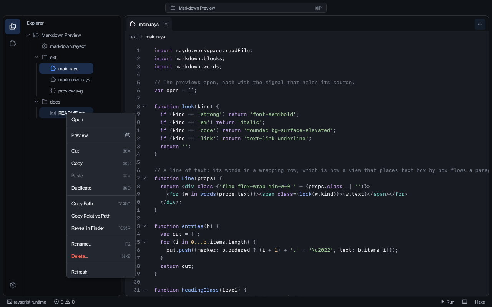

## Installed extensions

RayDE runs installed extensions in Haxe, extension and theme projects. Each extension has its own VM on a runtime thread inside RayDE; opening the Extension Studio is not required.

Uncaught RayScript exceptions fail the affected fiber and are reported in the extension's Output channel; other fibers and subsequent events continue in the same host. The VM uses Krio script fibers; a script exception does not panic RayDE. Native libraries execute inside RayDE and native faults can terminate the application.

| Scope | Folder |
| --- | --- |
| Built-in | Packaged with RayDE, under `extensions/`. |
| User | `~/.rayde/extensions/<id>/`. |
| Workspace | `.rayde/extensions/<id>/` under the project root. |

A folder contains a `.rayext` file and its scripts. The config's `id` identifies the extension; it defaults to the config's file name without its extension. A workspace copy replaces a user copy of the same id, which replaces the built-in copy. Opening a `.rayext` project replaces the installed copy with the development project and enables the Studio's controls and mocks.

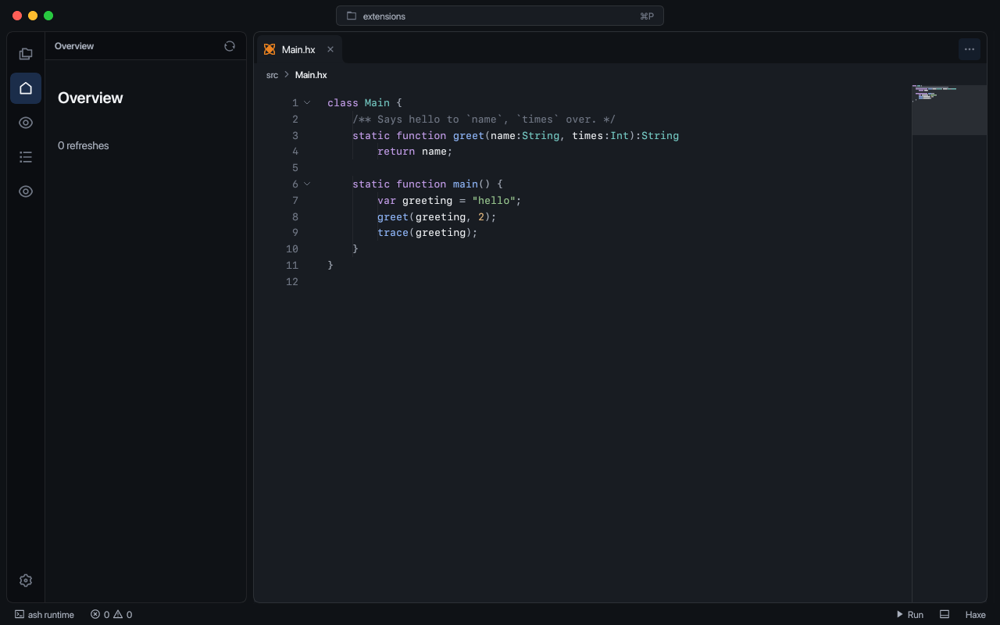

**Settings > Extensions** shows scope, state, the activation event, host state and capabilities. Its toggle stops or enables an extension for the workspace. Disabled ids are stored under `extensions.disabled` in `.rayde/settings.json`; the field overrides the same field in `~/.rayde/settings.json`.

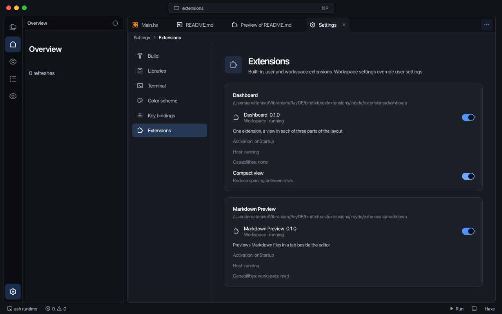

An extension starts on one of its `activationEvents`:

```json
{
  "id": "markdown",
  "activationEvents": ["workspaceContains:**/*.md", "onCommand:preview", "onView:preview"]
}
```

- `onStartup`: when the workspace opens. This is the default when `activationEvents` is absent. An empty list leaves the extension inactive.
- `workspaceContains:<glob>`: a matching path under the project root. `*` and `?` match within a path segment; `**` crosses folders.
- `onCommand:<id>`: when a contributed command is chosen. `*` matches several command ids. The command waits until the script registers its handler.
- `onView:<id>`: when the activity bar opens that view.

Views, commands and menu items from enabled extensions share the workbench. Views and command bindings are identified by their owning extension. A failed host is restarted at most three times in a minute; after the limit it stays stopped until disabled and enabled again. **Output** has a channel per extension for logs, errors and restart reports, alongside the Build channel.

`contributes.keybindings` supplies defaults such as `[{"command": "preview", "key": "mod+alt+p"}]`. Saved user bindings override them. The full command key is `ext.<extension-id>.<command>`; a saved `ext.<command>` binding migrates when exactly one installed extension declares that command. Ambiguous old bindings are kept for manual reassignment.

`contributes.configuration` accepts a schema with `properties`: boolean, string, number, integer and enum fields render under the extension's name in Settings. Values are stored in the `extension.<id>` section of the settings file, with workspace values overriding user values and schema defaults. A `describe` command returning structured state is the convention for extension inspection.

## The pieces

An extension is a folder with a config file and some scripts:

```
markdown/
  markdown.rayext        config: what the extension is and what it contributes
  ext/main.rays          entry script
  ext/markdown.rays      a module the entry script imports
  ext/preview.svg        the icon of the Preview command
  docs/README.md         a file to try it on
```

`scripts/rayde.sh path/to/markdown.rayext` opens the folder as an extension project: the Explorer lists the source folders, the config opens as a form, and the extension runs in the **Extension Studio**, which reloads it while it is edited and shows what it draws.

### The config

```json
{
  "name": "Markdown Preview",
  "main": "ext/main.rays",
  "sources": ["ext", "docs"],
  "capabilities": ["workspace.read"],
  "contributes": {
    "commands": [{"id": "preview", "title": "Preview", "icon": "ext/preview.svg"}],
    "menus": {
      "explorer/context": [{"command": "preview", "when": {"kind": "file", "ext": [".md", ".markdown"]}}],
      "editor/title": [{"command": "preview", "when": {"kind": "file", "ext": [".md", ".markdown"]}}]
    }
  }
}
```

- `main` is the entry script. `sources` are the folders it can import from (`import markdown.words;` reads `ext/markdown.rays`, since the first source is the import root) and the folders the Explorer shows.
- `capabilities` are what the extension may ask the workbench for. `workspace.read` lets it read files; `workspace.write` lets it write them. A call without the capability is rejected with the name of the one it needs.
- There is no `view`: the extension only handles hooks and commands and presents tabs, so it takes no place in the layout, and the Explorer keeps the sidebar. An extension gets a view only by asking for one, under [Views](#views).
- `contributes` adds commands and menu items, below.

The **Extension** page of Settings edits these fields and preserves entries it does not expose. *Open as JSON* opens the text, including native declarations.

### Native libraries

Declare each library under `natives`, with a matching `native:<name>` capability:

```json
{
  "capabilities": ["native:git2"],
  "natives": {
    "git2": {
      "path": "natives/libgit2.dylib",
      "sha256": "<64 hexadecimal digits>"
    }
  }
}
```

The name is the logical library in a RayScript `native "git2"` block. Paths are relative to the `.rayext` file. Absolute paths, traversal and symlinks outside the extension folder are rejected. The host verifies SHA-256 against a private copy before making any declared library available; replacing the installed file afterwards cannot change those bytes. The copied directory layout is preserved for dependencies between declared libraries.

**Settings > Extensions** shows each library's path, hash and approval state. User, workspace and development extensions wait for every library to be approved. **Approve** grants native execution; **Revoke** stops the host and clears its views. Approvals are stored under `extensions.nativeApprovals` in `~/.rayde/settings.json`, bound to the extension id and location, library name, path and hash. Workspace settings cannot grant approval. A changed path, hash or extension location requires approval again. Built-ins are pre-approved and still undergo the same host validation. Validation failures appear in the extension's Output channel and block execution until it is restarted.

Approval trusts the extension's scripts to call native code with your account permissions. It does not sandbox C code or verify script declarations against a library's ABI. Hashes cover declared library files; the operating system resolves their dependencies. Ship non-system dependencies as declared libraries, keeping their relative layout. Native faults remain confined to the extension's host process. The current native ABI target is macOS arm64.

## Views

A view is a part of the layout that shows an extension continuously, as opposed to a tab opened for a file. The Markdown preview declares none. Views are declared with `view` (one) or `views` (several):

```json
"views": [
  {"id": "main", "title": "Overview", "icon": "home", "location": "sidebar",
   "tools": [{"id": "refresh", "title": "Refresh", "icon": "refresh"}]},
  {"id": "inspector", "title": "Inspector", "icon": "eye", "location": "secondary"},
  {"id": "log", "title": "Log", "icon": "list", "location": "panel"}
]
```

and each is mounted under its id:

```
mount(() -> <Overview/>, 'main');
mount(() -> <Inspector/>, 'inspector');
mount(() -> <Log lines={lines}/>, 'log');
```

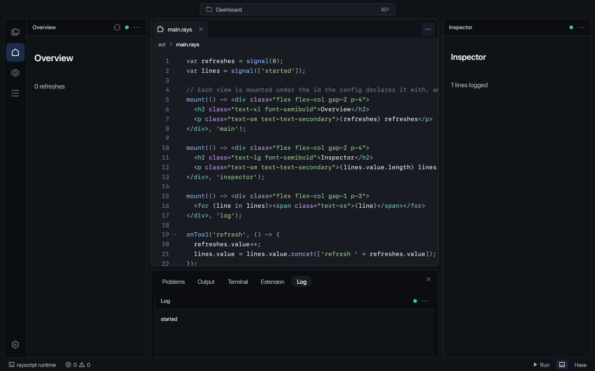

| Location | Where | Its icon |
| --- | --- | --- |
| `sidebar` | the side panel, in the Explorer's place | in the activity bar, selected while the view is showing |
| `secondary` | the right side bar | in the activity bar; it shows or hides the side bar |
| `panel` | a tab of the bottom panel | in the activity bar; it shows or hides the tab |
| `editor` | a tab among the open files | in the activity bar; it opens the tab |

Views in the same location share it: the sidebar shows one at a time, switched with the icons; panel and editor views are a tab each; side bar views stack. Each view has its own title, `icon` (an SVG file or the name of one of RayDE's) and `tools`, which are buttons in the header handled with `onTool(id, handler)`. A script changes the first view's title with `setTitle(text)`. A name that is no view's id goes to the first view, and a view is mounted again, not added to, when the extension reloads.

Mounting a view the config does not declare is reported in the Studio's console. A tab is the exception: `mount(view, 'tab:Title')` needs no declaration, and is how a command presents something.

The **Views** card of the Extension page declares, edits and removes views, each with its location, title, icon and actions.

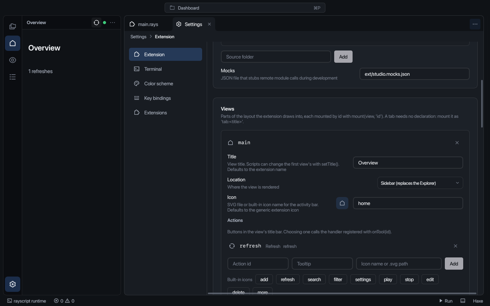

## Commands and menus

A command is an id the script registers a handler for:

```
registerCommand('preview', (args) -> show(args.path));
```

A menu item runs a command with `{path, kind}` of what the menu was opened on, where `kind` is `file` or `folder`. It appears when its `when` holds: all of the conditions it gives must match. `kind` is `file` or `folder`, `ext` lists extensions with their dot (compared without regard to case), and `name` is a pattern in which `*` matches any run of characters (`README*`).

There are two menu locations:

| Location | Where | Runs on |
| --- | --- | --- |
| `explorer/context` | the right-click menu of a file or folder in the Explorer | that row |
| `editor/title` | the editor's `…` menu | the file in front |

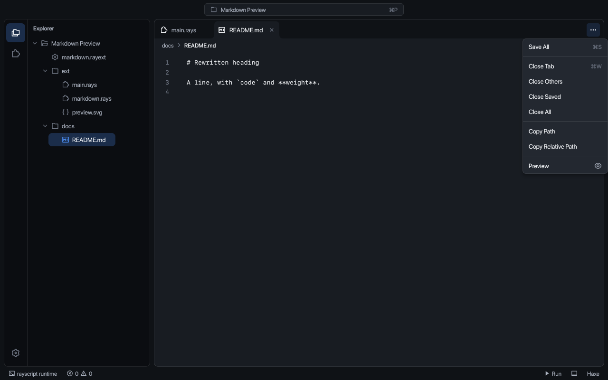

Commands are also in the command center (`>`), with the file in front, or the one selected in the Explorer, as `path`. Each is bound as `ext.<extension-id>.<command>` in **Key bindings**, and a menu shows its key beside the item.

An `icon`, on a command or on one menu item (the item's own wins), is an SVG file relative to the config, or the name of one of RayDE's own icons (`eye`, `refresh`, `star`; the Extension page lists them). A menu shows it at the right end of the item. A file that is missing is reported as a problem on the config.

## Hooks

Editor events reach an extension only if it asks for them with `onHook(name, handler)`:

| Hook | Called with | When |
| --- | --- | --- |
| `project.opened` | `{root}` | the project folder, once, when the extension subscribes |
| `active.changed` | `{path}` | the editor in front changed; `path` is null for a page that is not a file; also sent on subscribe |
| `file.opened` | `{path}` | an editor tab opened for a file |
| `file.closed` | `{path}` | an editor tab closed |
| `file.changed` | `{path}` | a buffer was edited; repeats within 300 ms become one call per file |
| `file.saved` | `{path}` | a buffer was written to disk |

The preview uses `file.saved` to redraw: its handler reads the file again and sets the signal the view reads.

```
onHook('file.saved', (e) -> {
  for (p in open) {
    if (p.path == e.path) p.source.value = await readFile(e.path);
  }
});
```

A name that is not in the table is reported in the Studio's console. The **Hooks** card of the Extension page lists the events and shows which the running extension listens for.

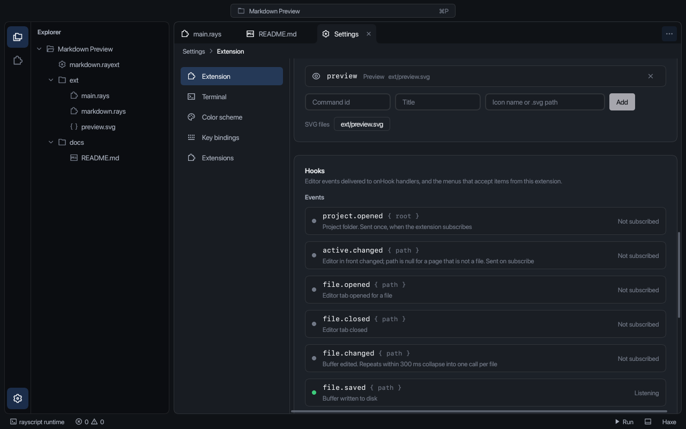

## Reading files

The extension asks the workbench for files through the `rayde.workspace` module:

| Function | Capability | Returns |
| --- | --- | --- |
| `readFile(path)` | `workspace.read` | the text of the file, as the editor holds it when the file is open |
| `activeFile()` | `workspace.read` | the path of the file in front, or null |
| `root()` | `workspace.read` | the project folder |
| `openFile(path)` | `workspace.read` | opens the file in a tab |
| `writeFile(path, text)` | `workspace.write` | writes the file; an open buffer is updated too |

Paths are resolved against the project folder, and one outside it is refused. Calls return promises, so a script `await`s them. `readFile` answers from the buffer when a file is open, which is why the preview shows an edit as soon as it is saved.

`rayde.settings.get(key, fallback?)` returns a promise for the calling extension's own setting. Workspace values under `extension.<id>` in `.rayde/settings.json` override user values in `~/.rayde/settings.json`, then the manifest's configuration default and finally the supplied fallback. Reading this section needs no workspace capability and cannot access another extension's section.

## Showing a tab

`mount(view, name)` puts a view where the extension's view goes. A name that starts with `tab:` opens an editor tab titled with the rest of it:

```
mount(() -> <Document source={source} path={path}/>, 'tab:Preview of ' + name(path));
```

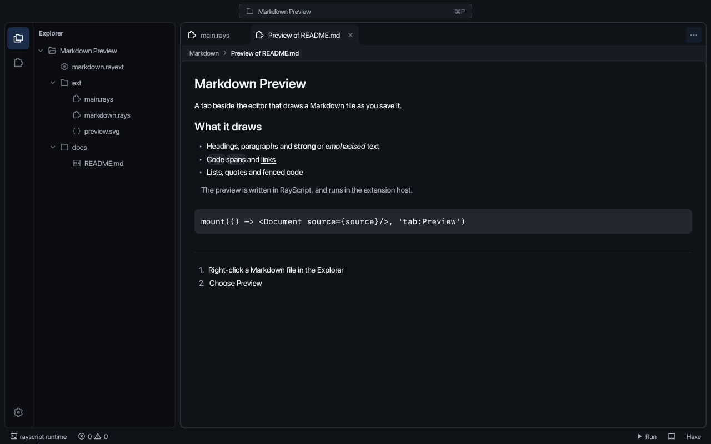

Closing the tab tells the extension, which unmounts the view; the cleanups the view registered with `onCleanup` run. The preview uses that to forget the file:

```
function Document(props) {
  onCleanup(() -> forget(props.path));
  ...
}
```

Markdown is a few hundred lines of RayScript in [`markdown.rays`](../tests/fixtures/markdown/ext/markdown.rays): `blocks(source)` splits a document into headings, paragraphs, lists, quotes, fenced code and rules, and `words(line)` breaks a line into words tagged with the emphasis, code or link they came from. The view is ordinary markup, `<div>`, `<span>` and utility classes, which the Preview draws with the same classes as ashui (`flex`, `gap-2`, `text-sm`, `bg-surface-elevated`).

## Ashui controls and interactive drawing

Extension markup can use native Ashui components through the same view bridge:

```haxe
var branch = signal('all');
<ui-select value={branch} options={[{value:'all', label:'All references'}]}
  onChange={e -> branch.value = e.value}/>;
<ui-button variant="outline" disabled={busy} onClick={() -> refresh()}>Refresh</ui-button>;
```

`ui-button` accepts text or markup children, `disabled`, `variant` (`primary`, `secondary`, `outline`, `ghost`, `link`, `destructive`) and `size` (`sm`, `md`, `lg`). `ui-select` accepts `value`, `disabled`, `size` and `options`: `{value, label, disabled?}` records. It emits `change` with `{value}`. Both use Ashui's focus and keyboard handling. Their default row height is 32 px; numeric `height` permits 16–256 px for dense lists. CSS sets the wrapper's width, placement and component custom properties.

`ui-icon` renders Ashui's named icon set through its `name` property, at 16 px by default. Icon buttons accept `size="icon"`, `aria-label` and a static `tooltip`, for example `<ui-button size="icon" tooltip="Maximize graph"><ui-icon name="maximize"/></ui-button>`. The tooltip also supplies the accessible label. `maximize` uses the pack's `fullscreen-line` SVG; `fetch`, `pull`, `push`, `focus` and `filter-off` are also available.

`ui-menu` is Ashui's native DropdownMenu with an icon-sized chevron trigger. It takes `tooltip`, `disabled` and `options` (`{value, label, disabled?}`), and emits `select` with `{value}`. Its keyboard navigation, focus restoration and dismissal use the native component.

`canvas-kit` retains a serializable drawing scene and runs Ashui CanvasKit in the editor:

```haxe
var drawing = signal({
  bounds: {x:0, y:0, width:300, height:160},
  commands: [
    {type:'path', path:[['M',40,80],['C',100,80,160,40,220,40]], color:'textLink', stroke:2},
    {type:'circle', x:40, y:80, radius:6, color:'accent'},
    {type:'text', x:60, y:85, text:'Commit', color:'textPrimary', size:13}
  ],
  regions: [{id:'commit', x:20, y:60, width:260, height:40}]
});
<canvas-kit class="flex-1 min-h-0" scene={drawing}
  onClick={e -> select(e.region)}/>;
```

Scene commands are painted in order. Coordinates and sizes are content units. Colors are RGB integers or camelCase Ashui theme tokens; command `alpha` defaults to 1 and multiplies the theme color's alpha. `stroke` is a constant screen-pixel width; zero fills a shape.

| Command | Fields |
| --- | --- |
| `path` | `path`: arrays `['M',x,y]`, `['L',x,y]`, `['C',x1,y1,x2,y2,x,y]`, `['Z']`. |
| `circle` | `x`, `y`, `radius`. |
| `rect` | `x`, `y`, `width`, `height`, optional corner `radius`. |
| `text` | `text`, `x`, baseline `y`, optional `size` and `weight`. |

`regions` are unique string ids with rectangular bounds, used for local hover and selection. `selected` accepts an array of ids. Optional handlers receive `click` `{region,x,y,shift,control,meta}`, `hover` `{region}` (null on leave) and `selectionChange` `{ids}`. Event coordinates are local screen coordinates.

The wheel zooms at the pointer; dragging empty space or using the middle/right button pans. Shift-drag selects a rectangle. Commit positions remain script data; gestures do not move the drawing's objects. Painting, hover highlighting, pan and zoom run locally without script calls per frame. Scene updates decode paths once and cull offscreen shapes and text; paths remain in paint order.

For linear lists, set `navigation="scroll"` when mounting the canvas. Ashui Scroll uses a nonpainting spacer for the full scene extent, with native wheel/trackpad scrolling and scrollbars. The canvas stays viewport-sized at fixed scale and renders only visible geometry and hit regions. Hover and region selection remain available; pan/zoom gestures are disabled. Coordinates start at the content's top left. Only `reset` commands apply in this mode, resetting the scroll position; it otherwise survives presentation rebuilds. Both Git graph views use this mode.

Set `command` to `{action:'fit'}`, `{action:'reset'}` or `{action:'zoom',factor:1.25}`. A changed `sequence` field repeats an otherwise identical command. Commands run after layout; `fit` uses full scene `bounds`, including offscreen regions. The viewport survives tab presentation rebuilds, and native control owners are disposed when views are hidden or removed. Invalid live properties report an extension error and preserve the last accepted property. Drawing, region and aggregate path-segment lists are limited to 50,000 entries.

`ui-panel-group` composes Ashui `Resizable`, `ResizablePanel`, `Collapsible`, `CollapsibleTrigger` and `CollapsibleContent` into vertical, named panels:

```haxe
<ui-panel-group class="flex-1 min-h-0" panels={[
  {id:'changes', title:'Changes', open:true, minSize:32},
  {id:'graph', title:'Graph', open:true, size:324, minSize:32}
]}>
  <div slot="changes" class="flex-1 min-h-0 overflow-auto">Changes</div>
  <div slot="graph" class="flex-1 min-h-0">Graph</div>
</ui-panel-group>;
```

`size` and `minSize` are layout pixels; an unsized panel shares the remaining space. Native divider dragging, arrow-key resizing and double-click reset apply. Headers toggle with pointer, Enter or Space. Closing a panel reduces it to its header; reopening restores its expanded size. Panel sizes and open states survive presentation rebuilds. `onPanelChange` receives `{id,open}`. The panel list is fixed for a mounted group (at most 16, with unique ids); children route through their `slot` property. Panel content owns its own scrolling.

The [Git history graph](git.md) combines these controls with a RayScript DAG layout and native libgit2 history pages.

## The Extension Studio

Opening a `.rayext` runs the extension. Its views are drawn in the Preview at the `location` each declares; an extension with no view shows only the tabs it opens. The Studio's console, activity and elements are in the Extension tab of the bottom panel.

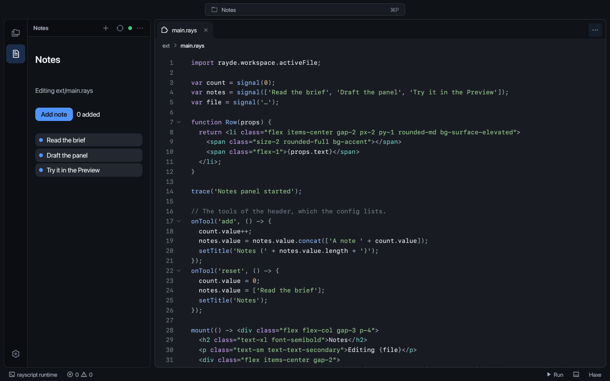

- **Reload:** saving or typing reloads the extension after a pause of 0.4 s; *Disable live reload* in the view's `…` menu leaves reloading to Run. A script with an error does not replace what was drawn: the last view that ran stays, marked as such, and the error is in Problems on its line.
- **Console:** what the script traces, and every error with its place, which opens the file there.
- **Activity:** the calls, hooks and commands that went to and from the extension, and what answered each.
- **Elements:** the tree the extension drew, with the events each node listens for.
- **Mocks:** a module the extension imports from elsewhere is answered from the `mocks` file of the config (`ext/studio.mocks.json`) while it is developed, and a mock takes precedence over a real answer from the workbench, so a script can be tried against files that are not in the project.

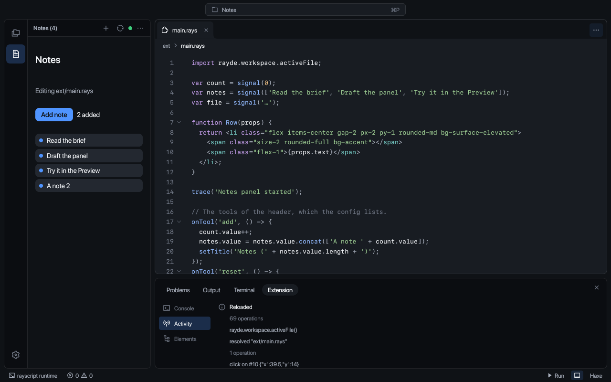

## Debugging

An extension stops at a breakpoint and its state can be inspected.

- **Setting:** click in the gutter beside a line of a `.rays` file, or put the cursor on it and choose **Toggle Breakpoint** (F9). A red dot marks the line.
- **Storage:** breakpoints are kept with the project (`breakpoints` in `.rayde/settings.json`) and move with the text. A line with no code moves the breakpoint to the next line that has some.
- **List:** the Debug part of the panel lists them; a row opens its line and its button removes the breakpoint.

The extension stops before the marked line runs. The editor goes to the line and marks it, and the Extension panel shows **Debug**:

- the toolbar: **Continue** (F5, which is Run while the extension is stopped), **Pause** (F6, for a script that is running), **Step Over** (F10), **Step Into** (F11) and **Step Out** (Shift+F11);
- the **call stack**, innermost first; choosing a frame opens its line and shows its variables;
- the **variables** of the frame, its locals and then those of its module; a value with members (an array, an object, a map, a signal) opens to show them;
- a field that **evaluates** a name and a path of members and indexes in the frame (`entry.amount`, `todo.items[2].title`), not arithmetic or calls.

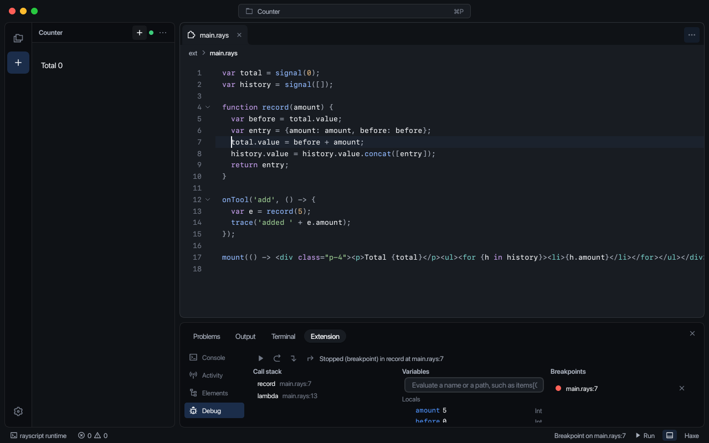

Nothing of the extension runs while it is stopped: events and hooks that arrive are held and run when it continues, and what the stopped code changed in the view is drawn then. A breakpoint in a handler stops the extension when the view is clicked or a header action is chosen.

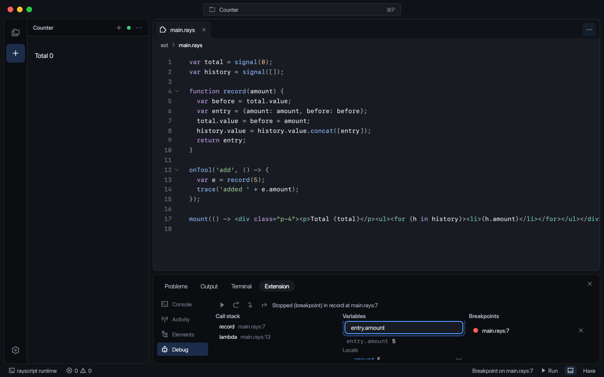

The debugger is in the VM and costs nothing without breakpoints: a breakpoint replaces one instruction, with the original kept.

## Trying it

```sh
scripts/rayde.sh tests/fixtures/markdown/markdown.rayext   # right-click docs/README.md, choose Preview
scripts/check.sh                                           # embedded extension VMs, with the workbench's answers played by the test
SNAPSHOT_ONLY=markdown scripts/snapshot.sh                 # the menu, the tab, a save, closing it, and the config form, into bin/snapshots
SNAPSHOT_ONLY=extensions scripts/snapshot.sh               # two installed extensions, commands, restart, configuration and toggles
SNAPSHOT_ONLY=debug scripts/snapshot.sh                    # a breakpoint, the stop, the variables, stepping and going on
```

`native/rayscript` embeds the RayScript host library as `rayscript.hdll`, loaded through Haxe externs. Owned messages cross in-memory queues; VM values and pointers stay on the runtime thread. Closing a tab cancels its event fibers and their spawned children, unmounts the view, and requests collection at a safepoint. Late service replies do not resume cancelled fibers. Hiding a sidebar releases its native presentation and requests collection while retaining its mounted view state. Disabling, reloading or closing the workspace cancels all live script fibers, runs view cleanups, and releases the VM and native resources on the runtime thread. Collection requests and shutdown do not block the UI thread; an in-flight native call must return before its library can be released. The standalone `rayscript-host` remains available for backend tooling.

## Limits

- `setTitle` changes the first view's title; the others keep the title they declare.
- The Explorer of an extension project lists its `sources` and the config, not the whole folder: the sample lists `docs` as a source so `README.md` has a menu.
- Only `workspace.read` and `workspace.write` are backed by a service. The other capabilities in the form (`process.spawn`, `net.fetch`, `terminal`, `clipboard`) are recorded in the config and not yet acted on.
- The Preview lays text out box by box, so inline emphasis inside a paragraph needs the per-word markup `words()` produces; ashui's inline flow is not attached to extension markup.
- A menu icon sits inside the item's label, at its right end, until ashui's menu items take an icon of their own.
- A call that a built-in makes back into the script (`array.map(f)`, a computed value, an effect) cannot be stopped in, and the extension does not stop on an error or on a `debugger` statement.
- Evaluation takes names, members and indexes only, and the variables of an enclosing function that a closure captures are not named.
