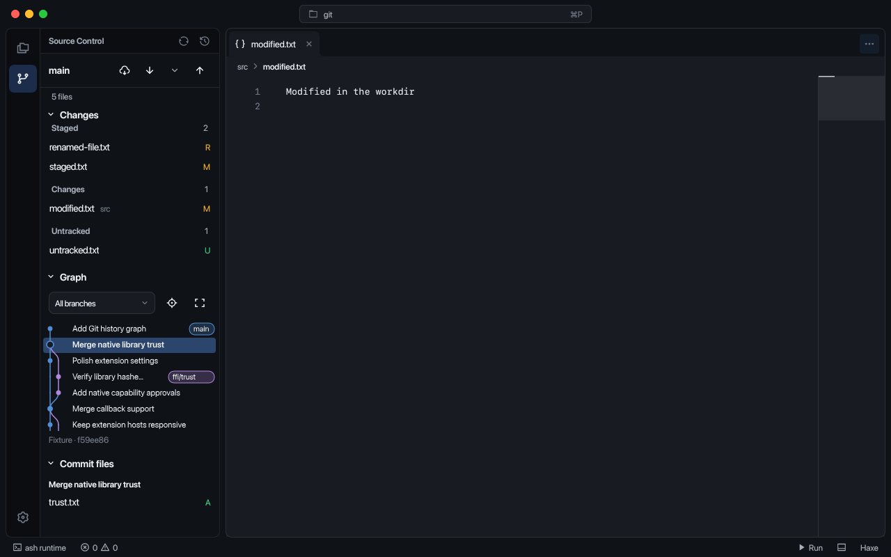
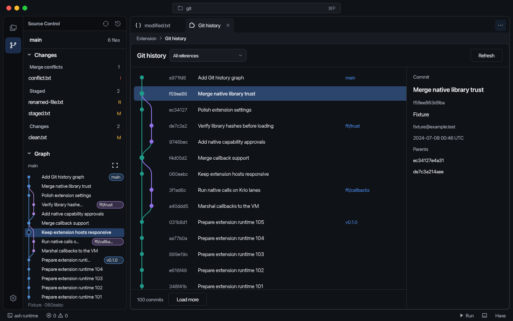

# Git

Select the branch icon in the activity bar to open **Source Control**. It groups conflicts, staged changes, working changes and untracked files. Select the branch name in the status bar to return to this sidebar.

## History

The sidebar has resizable **Changes**, **Graph** and **Commit files** panes. Select a commit to see its changed files. The graph's maximize button opens the expanded history tab; pressing it again returns to the same tab.

Scroll with the wheel, trackpad or scrollbars. **Load more** fetches older commits. The reference picker filters to the current branch, another reference or the selected commit; **Show all references** removes the filter. **Refresh** reloads status and history.

## Diffs

Select a changed file to open its diff. Staged files compare with HEAD; working changes compare with the index. A commit's files compare with its first parent. Conflicts open the source file instead.

The diff toolbar switches between side-by-side and inline layouts. **F7** and **Shift+F7** move between changes. Use a file row's code icon to open the source. Binary files show a note in place of a text diff.

## Remotes

The branch header offers **Fetch**, **Pull** and **Push**. Push uses the upstream or the default remote and matching branch name; it never force-pushes.

**Pull options** selects fast-forward, merge or rebase for one pull. **Settings > Extensions > Git > Pull strategy** changes the default. Pull requires a clean working tree and index. SSH uses system OpenSSH; private HTTPS credential helpers are not connected yet.

Operation results and errors appear in notifications and the Git Output channel. **Show Output** opens the full message.
