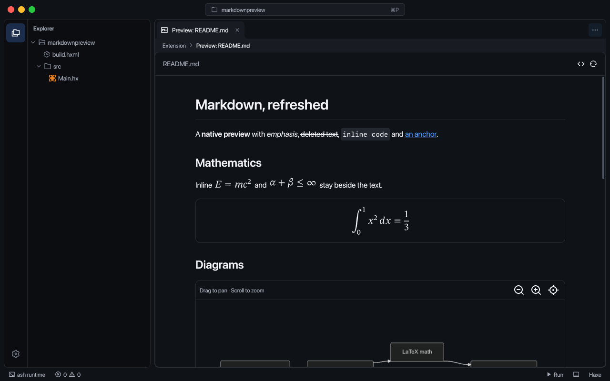
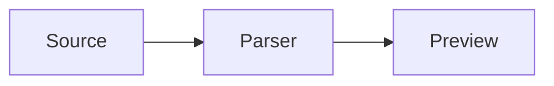
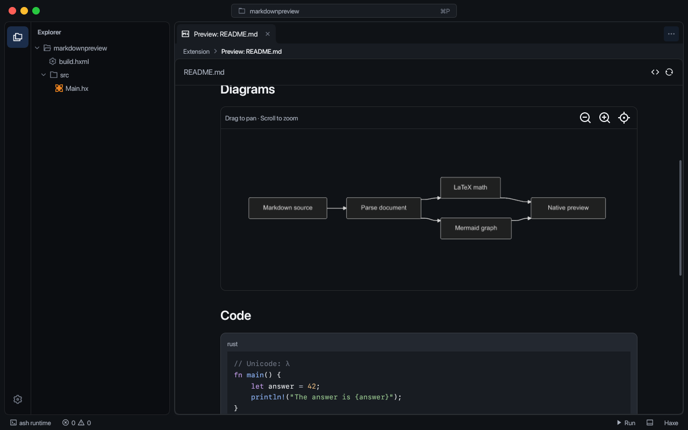
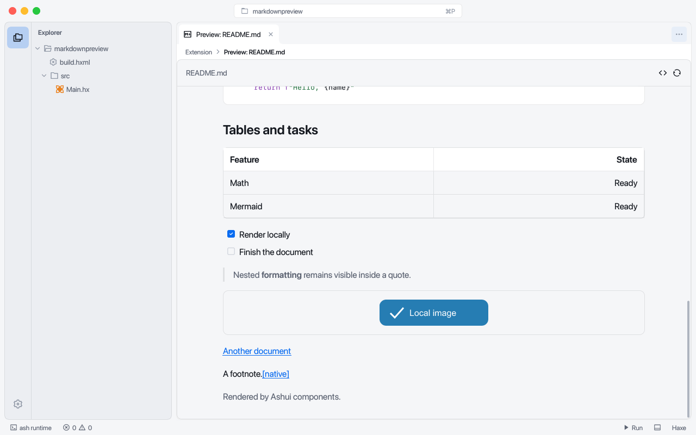

# Markdown preview

The built-in Markdown extension opens editor tabs. **Markdown: Open Preview** uses the active Markdown file; the Explorer and editor menus pass the selected file. The preview and its command use Remix's Markdown icon. The extension contributes no sidebar view.

Edits update an open preview after the editor's change debounce, including unsaved buffers. Opening the same preview again focuses its existing tab. The source and refresh actions have icon tooltips. Closing a preview, including through a bulk close action, releases its view, generated SVGs and code viewers.

## Rendering

The parser supports CommonMark with GFM tables, task lists, strikethrough, autolinks and footnotes. Nested emphasis, ordered and unordered lists, block quotes, fenced code and heading anchors are rendered with Ashui components. Local PNG, JPEG, WebP and SVG images resolve relative to the Markdown file. Relative document links open another preview; other file links open the editor. HTTP, HTTPS and mailto links open in the system handler after a click.

Task lists use read-only Ashui checkboxes. Checked and unchecked markers share the same 14 px square and spacing.

Inline math uses `$...$`. Display math uses `$$...$$` or a fenced `math`/`latex` block. LaTeX-Rust typesets fractions, roots, integrals, sums, Greek and mathematical symbols, accents and supported matrix/alignment environments into SVG paths using its embedded STIX Two Math font. This is mathematical LaTeX, rather than a LaTeX document compiler.



````markdown
The identity $E = mc^2$ appears within a paragraph.

$$
\int_0^1 x^2\,dx = \frac{1}{3}
$$


````

Mermaid fences use the pinned native Mermaid renderer's diagram families, including flowcharts, sequence, class, state, ER, pie, mindmap, journey, timeline, Gantt, requirement, Git, C4, Sankey, quadrant, ZenUML, block, packet, Kanban, architecture, radar, treemap and XY charts. Drag to pan and use the wheel to zoom around the pointer. Zoom in, zoom out and fit controls have tooltips. The SVG follows the CanvasKit viewport and remains sharp when scaled; the canvas occupies the visible diagram area.





Malformed equations and diagrams show an error and their source within the document. Other blocks continue rendering. Raw HTML is shown as text. Remote images are not fetched automatically. Preview documents are limited to 2 MiB, local image files to 8 MiB, and Mermaid fences to 32 KiB/500 lines.

## Shared syntax highlighting

Fenced code consumes [RayDE's syntax system](syntax.md). Language flags such as `rust`, `python`, `c++`, `bash` and `ts` resolve through the shared registry. Unknown flags remain readable plain text. Code blocks are read-only Ashui code viewers with selection, copying and scrolling.

The old `tests/fixtures/markdown` extension remains a small extension-authoring demonstration. The production implementation is `extensions/markdown`; `markdownpreview` snapshots install and exercise that implementation in an ordinary Haxe workspace.
