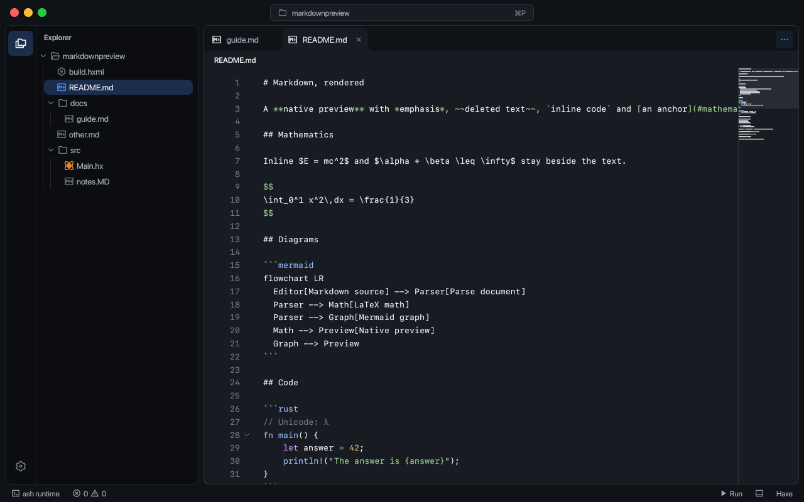
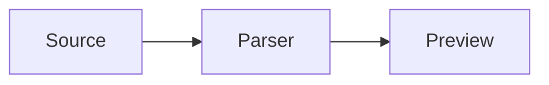
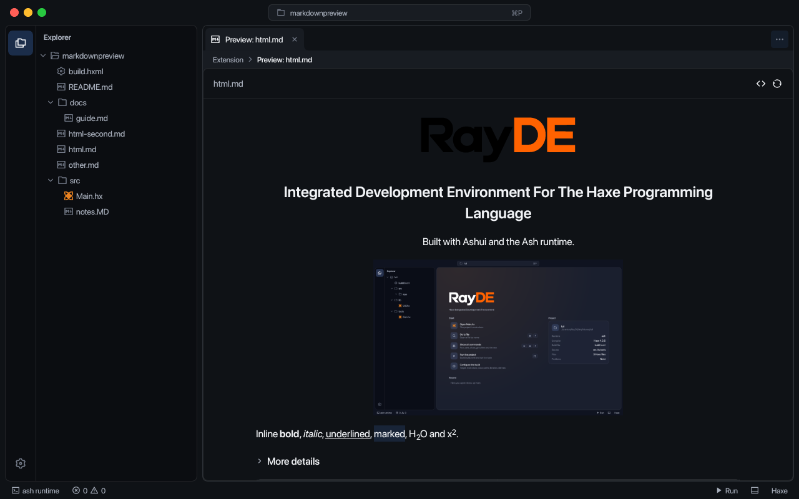
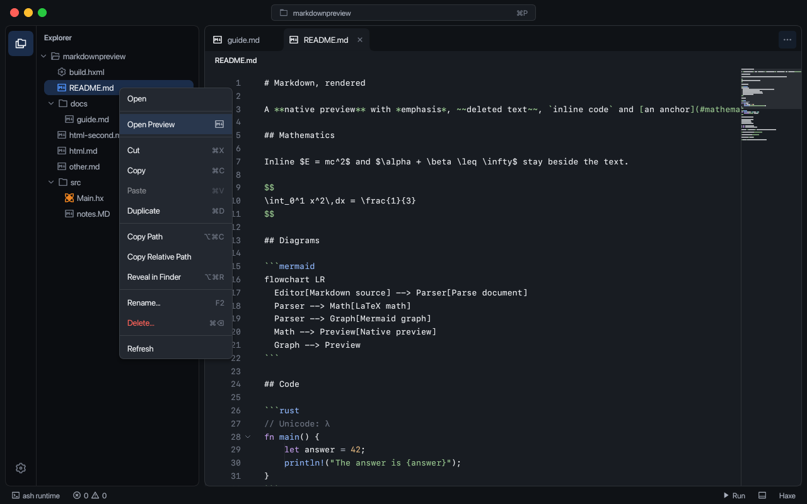

# Markdown preview

The built-in Markdown extension opens editor tabs. **Markdown: Open Preview** uses the active Markdown file; **Open Preview** in the Explorer and editor menus passes the selected file. The preview and its command use Remix's Markdown icon. The extension contributes no sidebar view.

The Explorer includes Markdown in the project root, documentation folders and source folders. `.md`, `.markdown`, `.mdown` and `.mkd` are recognized without case sensitivity and use the Markdown icon. Source folders start expanded; other folders load when opened.

External class paths appear in Dependencies. Their Markdown files, relative links and local images can be previewed within the declared dependency roots. A failed read shows the file name and a Retry action; the notification's **Show Output** action reveals the full path and diagnostic details. A failed refresh keeps the last rendered document available.



Edits update an open preview, including unsaved buffers. Opening the same preview again focuses its existing tab. Source and refresh actions are available in its toolbar.

## Rendering

The preview supports CommonMark with GFM tables, task lists, strikethrough, autolinks and footnotes. Local PNG, JPEG, WebP and SVG images resolve relative to the Markdown file. Relative document links open another preview; other file links open the editor. Web and mail links open in the system handler after a click.

Task lists use read-only Ashui checkboxes. Checked and unchecked markers share the same 14 px square and spacing.

Inline math uses `$...$`. Display math uses `$$...$$` or a fenced `math`/`latex` block. Fractions, roots, integrals, sums, Greek symbols and supported matrix/alignment environments render as mathematical LaTeX.


````markdown
The identity $E = mc^2$ appears within a paragraph.

$$
\int_0^1 x^2\,dx = \frac{1}{3}
$$


````

Mermaid fences render diagrams. Drag to pan and use the wheel to zoom around the pointer, or use the zoom and fit controls.


Malformed equations and diagrams show an error and their source within the document. Other blocks continue rendering. Remote images are not fetched automatically. Preview documents are limited to 2 MiB, local image files to 8 MiB, and Mermaid fences to 32 KiB/500 lines.

## HTML and images

Supported HTML includes paragraphs, headings, containers, inline formatting, links, images, lists, tables, code and details/summary disclosures.

Use `align` or `style="text-align: ..."` for alignment. Images accept pixel `width` and `height`; width can also be a percentage. A single dimension preserves the aspect ratio, and images fit the document width.

Scripts, event attributes, forms, embedded pages and external stylesheets are omitted.

```html
<p align="center"></p>
<h2 align="center">Project title</h2>
<details><summary>More information</summary><p>Document content.</p></details>
```





## Shared syntax highlighting

Fenced code consumes [RayDE's syntax system](syntax.md). Language flags such as `rust`, `python`, `c++`, `bash` and `ts` resolve through the shared registry. Unknown flags remain readable plain text. Code blocks support selection, copying and scrolling.

The old `tests/fixtures/markdown` extension remains a small extension-authoring demonstration. The production implementation is `extensions/markdown`; `markdownpreview` snapshots install and exercise that implementation in an ordinary Haxe workspace.
