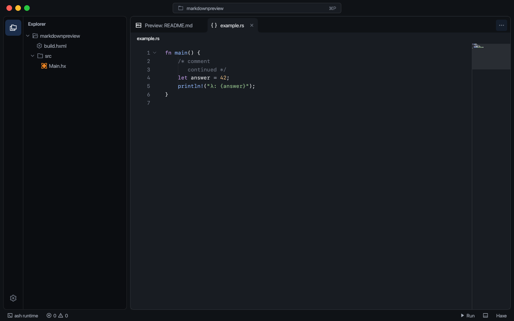

# Syntax highlighting

RayDE has a shared TextMate syntax system for ordinary code files and extension consumers. The Markdown preview uses this system for fenced blocks.

The pinned data bundle is `@wooorm/starry-night` 3.11.0: 731 grammar scopes, their language names and aliases, and file extensions derived from GitHub Linguist. This is the complete bundle at that version, rather than a claim that RayDE tracks every subsequent GitHub change. The [upstream project](https://github.com/wooorm/starry-night) documents its relationship to Linguist and includes the grammar license notices.

`native/rayscript/grammars/index.json` records the archive checksum, scope, file, names and extensions for each grammar. The source files are checked in. `node scripts/update-grammars.mjs` regenerates them from the checksum-verified archive; Node and network access are needed only for that update. Normal builds and the application use the embedded data, with no Node, browser or external highlighting process.

The native registry is initialized once and shared between the UI thread and embedded extension VMs. Grammars and regexes are compiled as needed. Ordinary code editors use incremental TextMate sessions: each line receives an incoming lexical state and returns tokens plus an interned outgoing state. Offsets are converted from UTF-8 bytes to Haxe's UTF-16 string indices. The native highlighter retains data, not a CodeEditor or owner. Closing a saved document releases its session; unsaved document data retains it until saved or discarded. The existing specialized Haxe and JSON highlighters remain in use for those documents.

TextMate scopes map to Ashui's supported token categories: keywords, strings, comments, numbers, types, functions, operators, tags, attributes and plain text. Theme colors come from the editor's existing token styles. Highlighting support does not install compilers or language servers for other languages.



Extensions can import the pure `rayde.syntax` module:

```haxe
import haxe.Json;
import rayde.syntax.highlight;
import rayde.syntax.languages;

var block = Json.parse(highlight("fn main() {}", "rust"));
var scopes = Json.parse(languages());
```

`highlight` returns JSON containing source text, language and per-line token ranges. The Markdown renderer uses the same implementation. `TextMateSyntax.fromTokens` adapts precomputed tokens to Ashui's `CodeHighlighter`, while `TextMateSyntax.forFile` owns an incremental native session for an editor document. Neither path draws a separate HTML editor.

Third-party notices are in `native/rayscript/notices` and copied beside the native libraries by packaging. Grammar filenames retain their upstream stem with `.json` in place of `.js`; the grammar data is converted without executing JavaScript at runtime.
