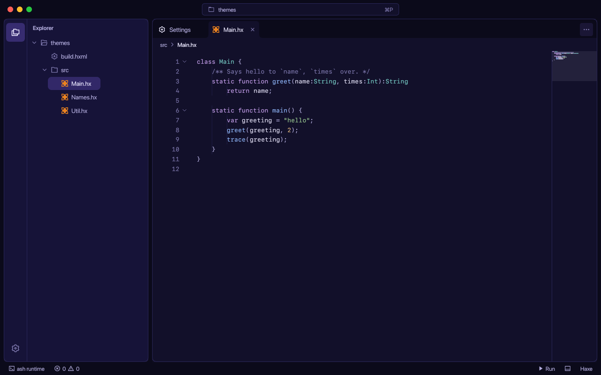
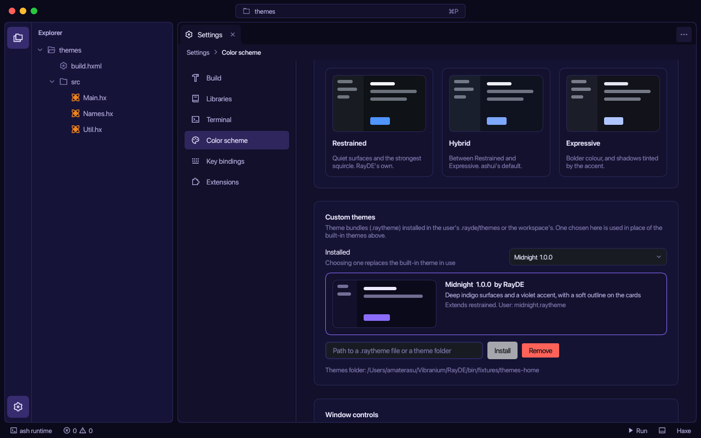
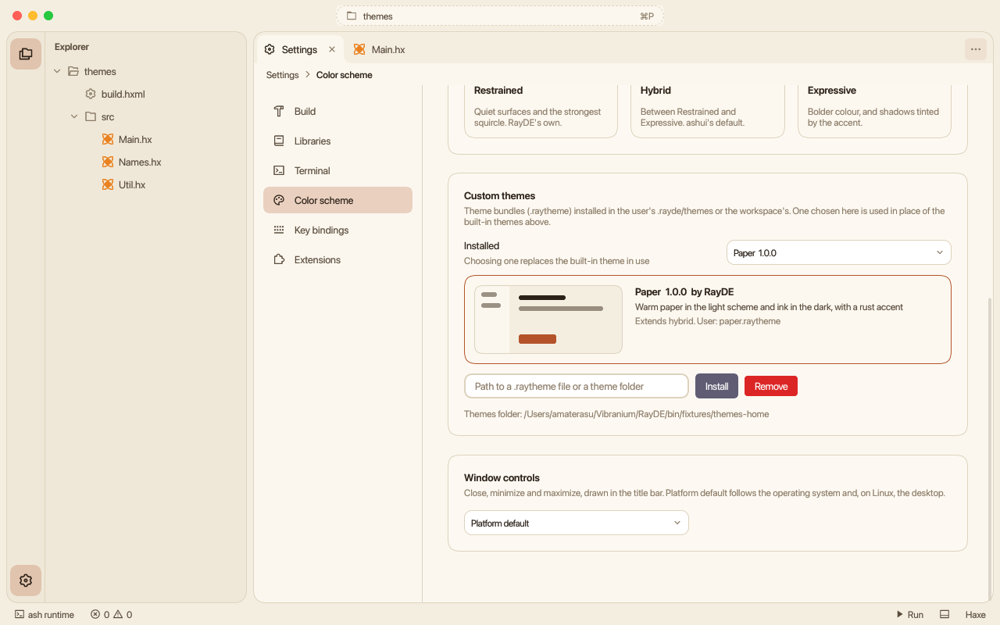
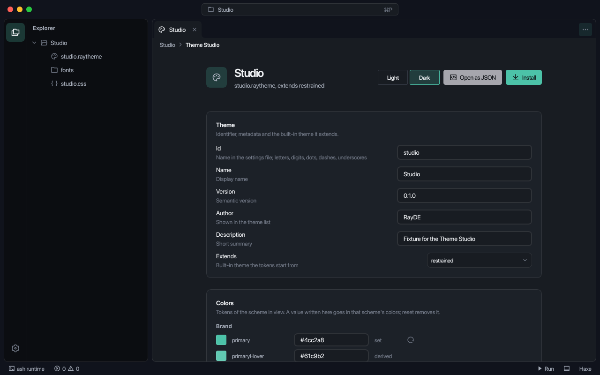
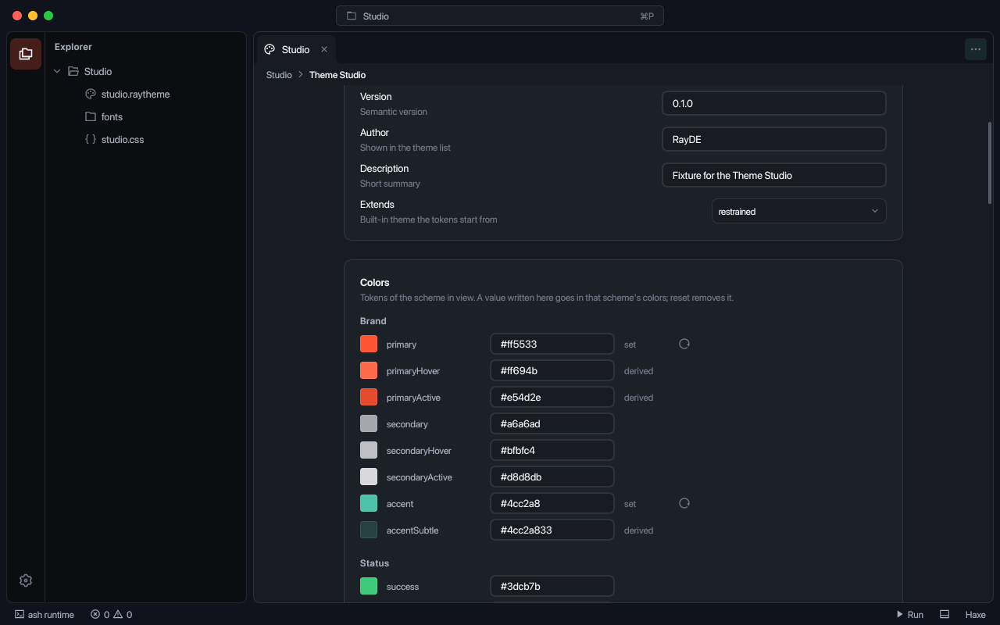
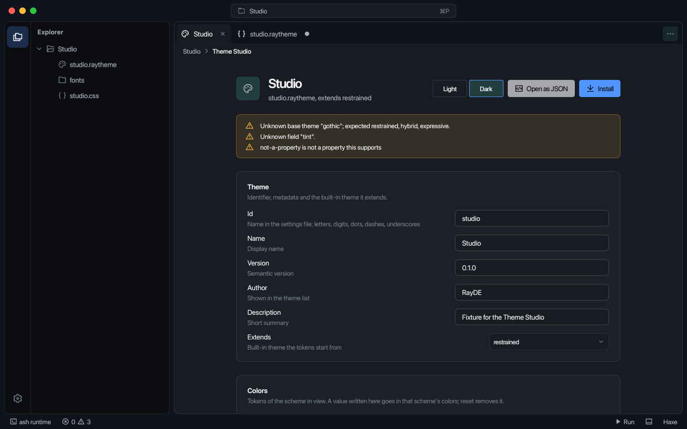
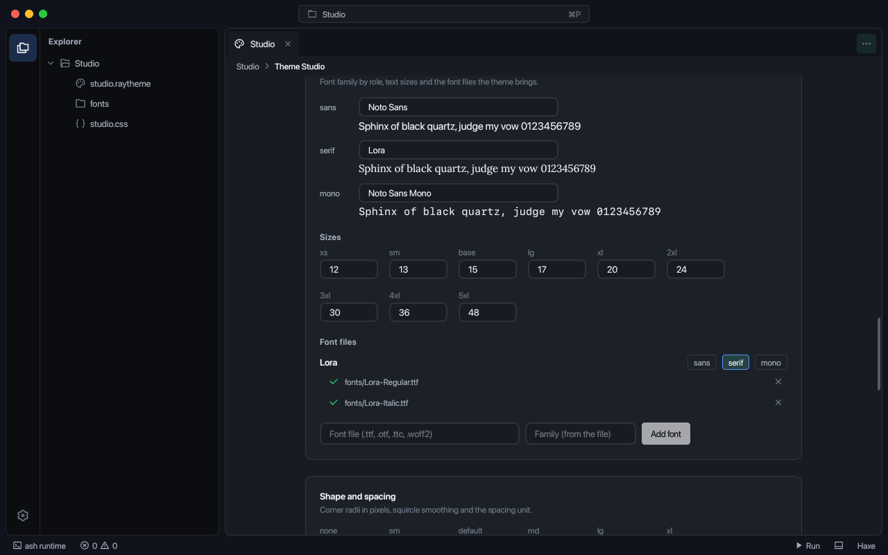

# Theme bundles

A theme bundle is a `.raytheme` JSON file. It extends one of RayDE's built-in themes (Restrained, Hybrid, Expressive) and changes colours, radii, type, fonts and CSS. Installed bundles are listed under the built-in themes in **Settings > Color scheme**; a chosen theme replaces the built-in ones. `rayde <name>.raytheme` opens the file in the Theme Studio. Examples: [`themes/midnight`](../themes/midnight) and [`themes/paper`](../themes/paper).



## File format

Smallest bundle:

```json
{
  "name": "Rust",
  "colors": {"primary": "#b4532a"}
}
```

Fields not named come from the base theme. Fuller form (Midnight, abridged):

```json
{
  "id": "midnight",
  "name": "Midnight",
  "version": "1.0.0",
  "author": "RayDE",
  "description": "Deep indigo surfaces and a violet accent",
  "extends": "restrained",
  "shape": {"smoothing": 0.8, "threshold": 10},
  "radii": {"xl": 16},
  "light": {"colors": {"background": "#f3f1ff", "primary": "#6a4cf0"}},
  "dark":  {"colors": {"background": "#0b0a1a", "primary": "#8b6cff"}},
  "css": [{"file": "midnight.css"}]
}
```

| Field | Value |
| --- | --- |
| `id` | Name stored in `appearance.theme`. Defaults to the file name. Letters, digits, `.`, `-`, `_`; not a built-in id. |
| `name`, `version`, `author`, `description` | Shown in Settings and the Studio header. |
| `extends` | `restrained` (default), `hybrid` or `expressive`. |
| `colors` | Token to colour, both schemes. |
| `radii` | Corner radius in px: `none`, `sm`, `default`, `md`, `lg`, `xl`, `2xl`, `3xl`, `full`. |
| `shape` | Squircle corners: `smoothing` (0 to 1), `exponent`, `threshold` (smallest radius that is smoothed). |
| `typography` | `sans`, `serif`, `mono` family names; `sizes` for `xs` to `5xl` in px. |
| `spacing` | `base`: the unit of the spacing scale, px. |
| `fonts` | Font files the theme brings. See [Fonts](#fonts). |
| `css` | Text, list, or `{"file": "x.css"}`. See [CSS](#css). |
| `light`, `dark` | Any of `colors`, `radii`, `shape`, `typography`, `spacing`, for one scheme. They win over the shared fields. |

### Colours

A colour is `#rgb`, `#rrggbb`, `#rrggbbaa`, `rgb(r, g, b)`, `rgba(r, g, b, a)` or `transparent`. A token is named as in ashui (`surfaceElevated`) or with dashes (`surface-elevated`).

| Group | Tokens |
| --- | --- |
| Brand | `primary`, `primaryHover`, `primaryActive`, `secondary`, `secondaryHover`, `secondaryActive`, `accent`, `accentSubtle` |
| Status | `success`, `warning`, `error`, `info`, each with a `Bg` variant |
| Surfaces | `background`, `surface`, `surfaceElevated`, `surfaceOverlay` |
| Text | `textPrimary`, `textSecondary`, `textTertiary`, `textInverse`, `textLink` |
| Borders | `border`, `borderSecondary`, `borderHover`, `borderFocus`, `borderError` |
| Inputs | `inputBg`, `inputBgHover`, `inputBgFocus`, `inputBgDisabled` |
| Other | `selection`, `selectionText`, `tooltipBg`, `tooltipText` |

Derived tokens, used when the file does not name them:

| Set | Derives |
| --- | --- |
| `primary` | `primaryHover`, `primaryActive`, `borderFocus`, `selection` |
| `secondary` | `secondaryHover`, `secondaryActive` |
| `accent` | `accentSubtle` |

## Fonts

`fonts` lists font files beside the theme file, grouped by family:

```json
{
  "typography": {"sans": "Lora", "serif": "Lora"},
  "fonts": [
    {"family": "Lora", "files": ["fonts/Lora-Regular.ttf", "fonts/Lora-Bold.ttf"]}
  ]
}
```

- Files are `.ttf`, `.otf`, `.ttc` or `.woff2`, as a path beside the theme file (no `..`, no drive).
- Files are registered with `ashui.text.Fonts` when the theme is in force. A face is found by the family name it carries, so `typography` and CSS refer to the family by that name.
- For TrueType and OpenType files RayDE reads the family from the `name` table and reports a file that carries another name than its entry. WOFF2 is not read.
- Roles: `sans` is the font of the interface and is applied to the window when the theme sets it; `mono` is the editor and terminal font; `serif` is available as `var(--font-serif)`.
- A family that is not listed is looked up as an installed font.
- Install copies the listed files with the theme.

## CSS

`css` accepts a text, a list, or `{"file": "x.css"}` for a file beside the theme file.

- Each selector is placed under the theme, so rules apply only while the theme is in use. Write `.rayde-card { ... }`, not `#rayde .rayde-card`.
- `:root` and `#rayde` stand for the theme itself: custom properties go there (`--ui-menu-bg`, `--ui-code-font`, `--ui-code-font-size`).
- Rules inside `@media`, `@supports`, `@container` and `@layer` are scoped. `@keyframes` and `@font-face` are kept as written.
- Sheets are loaded and removed with the theme: switching themes, or editing the CSS in the Studio, replaces them.

## Installing and choosing

**Settings > Color scheme > Custom themes** takes a path to a `.raytheme` file or a folder that contains one and installs it into `~/.rayde/themes`.

- A file is copied with the stylesheets and fonts it names. A folder is copied whole.
- A theme with problems is not installed; each problem is listed.
- Same id replaces the installed theme.
- Themes are read from `.rayde/themes` in the workspace, then `~/.rayde/themes`. `RAYDE_THEMES=<folder>` replaces the user folder.
- The chosen theme is stored in `.rayde/settings.json` as `appearance.theme`. It combines with the scheme setting.
- **Remove** deletes the theme in use and returns to Restrained.





## Theme Studio

`rayde path/to/name.raytheme` opens the file as a project. The Explorer lists the theme folder; the file opens as the Theme Studio page. **Open as JSON** opens the text.



The window wears the theme while it is edited. The theme is read again 250 ms after the last keystroke in the JSON editor, and immediately after a change made in the form.

| Part | Behaviour |
| --- | --- |
| Header | Light and Dark switch the scheme shown (stored in `appearance.scheme`). **Install** installs the file as it is on disk. |
| Problems | The file's problems, with the style system's warnings about the CSS. A problem opens the JSON at its entry; the same problems are underlined in the editor and counted in the status bar. |
| Theme | `id`, `name`, `version`, `author`, `description`, `extends`. |
| Colors | Every token of the scheme in view, with its value, whether it is `set` in the file or `derived`, an input, and reset. |
| Typography | A family per role with a specimen, text sizes, font files. |
| Shape and spacing | Radii, `shape` values and the spacing unit. |
| Stylesheets | Listed files, **Open**, and **Add stylesheet** (creates the file). |
| Preview | Buttons, badges, controls, alerts and the text scale in the theme. |



- A value that is in the file is replaced in place; the rest of the text keeps its layout. A new entry rewrites the file through an order-preserving writer: key order is kept, objects are laid out one entry per line.
- Colour inputs write to the section of the scheme in view (`dark.colors.primary`). Reset removes the entry; a value shared between schemes moves to the other scheme first.
- Text that is not a JSON object is an error and the last theme that read stays on the window. The Studio header says so.



### Adding fonts

**Font files** takes a path to a font file and an optional family:

- The file is copied to `fonts/` beside the theme unless it is already inside the theme folder.
- The family is read from the file; it is required for `.woff2`.
- The chips on a family (`sans`, `serif`, `mono`) set `typography.<role>` to it.
- The x on a file removes it from the theme; the file stays on disk.



## Implementation

See the [contributor reference](contributing/themes.md) for the theme classes, CSS scoping and checks.

## Limits

- Shadows and animation timings are not in the file.
- Images are not part of a bundle.
- Themes are chosen per project (`appearance.theme` in the workspace settings); a bundle is installed once per user.
