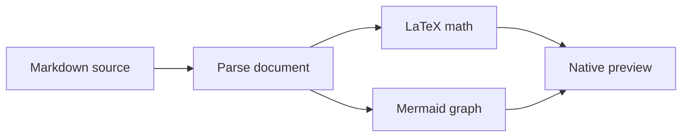

# Markdown, rendered

A **native preview** with *emphasis*, ~~deleted text~~, `inline code` and [an anchor](#mathematics).

## Mathematics

Inline $E = mc^2$ and $\alpha + \beta \leq \infty$ stay beside the text.

$$
\int_0^1 x^2\,dx = \frac{1}{3}
$$

## Diagrams



## Code

```rust
// Unicode: λ
fn main() {
    let answer = 42;
    println!("The answer is {answer}");
}
```

```python
def greet(name: str) -> str:
    return f"Hello, {name}"
```

## Tables and tasks

| Feature | State |
| :--- | ---: |
| Math | Ready |
| Mermaid | Ready |

- [x] Render locally
- [ ] Finish the document

> Nested **formatting** remains visible inside a quote.


[Another document](other.md)

A footnote.[^native]

[^native]: Rendered by Ashui components.
